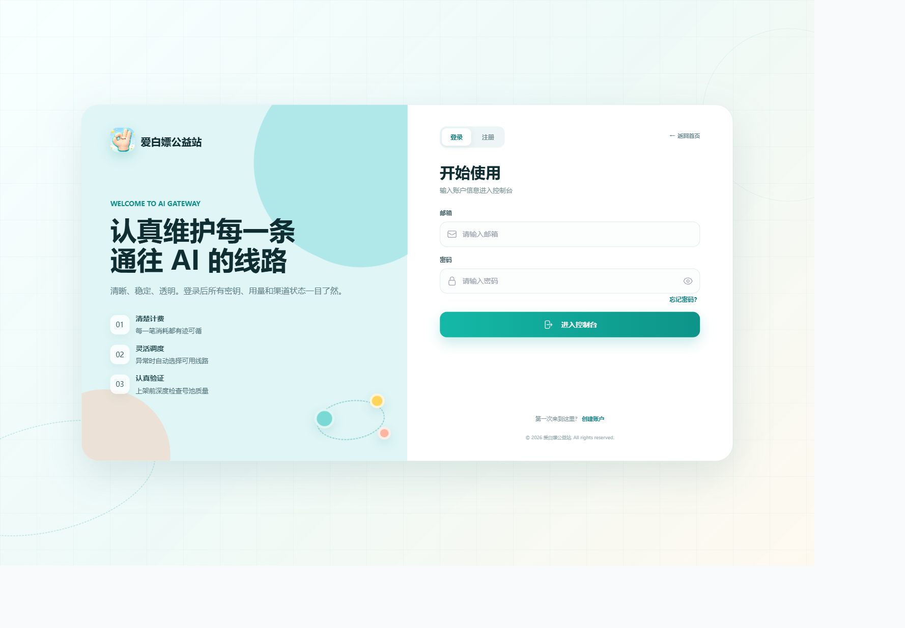
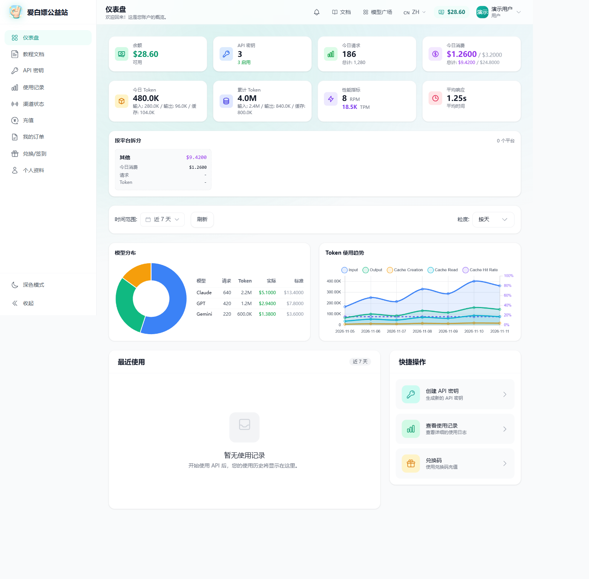

# 爱白嫖公益站

### 认真维护每一条通往 AI 的线路

多模型接入 · 清楚计费 · 渠道状态可查 · 在线生图

[**进入网站**](https://aibaipiao.top) · [**开始使用**](https://aibaipiao.top/register) · [**查看模型与价格**](https://aibaipiao.top/model-plaza) · [**使用教程**](https://aibaipiao.top/docs)

---

## 让 AI 用起来更清楚

写代码、做项目、学习探索，或把一个想法变成图片——爱白嫖把模型接入、密钥、用量、线路状态和充值放在同一个控制台里，让你更容易找到需要的模型，也能看清每一次使用的消耗。

## 本站特色

### 多种模型，一个入口

通过统一的 API 入口接入不同模型，配合你习惯的 AI 客户端、编程工具或应用使用。在「模型广场」查看可用模型、分组和价格，按需求选择合适的线路。

**先了解模型和费用，再决定怎么用。**

[查看模型与价格 →](https://aibaipiao.top/model-plaza)

### 每一笔消耗，都有迹可循

余额、今日消费、请求次数和 Token 用量集中展示。除了汇总数字，还能查看使用记录、模型分布和用量趋势，了解主要在用哪些模型、消耗发生在哪里。

- **余额与费用**：查看当前余额、今日消费和累计消费。
- **用量与趋势**：查看输入、输出和缓存 Token 的变化。
- **使用记录**：按时间筛选，查询具体请求的用量与费用。
- **模型分布**：直观看到不同模型的使用占比。

界面截图使用演示账号和示例数据，展示控制台的实际页面与图表。

### 线路状态，自己看得见

「渠道状态」提供可用性、响应延迟、历史状态及模型详情，让线路表现更直观。遇到使用问题时，可以先查看相关渠道的状态，再选择可用线路或反馈问题。

### 从想法到图片，在网页里完成

生图工作台支持设置模型、画幅、分辨率、质量和提示词，生成前查看费用预估。生成任务、图片预览和作品集中管理，完成后可下载图片。

**选好参数 → 输入描述 → 确认费用 → 查看并下载作品。**

### 充值与优惠，一次看清

支持快捷金额和自定义充值，结算时集中展示优惠、手续费、实付金额与到账额度，订单进度也可以在控制台查询。

符合条件时，可参与首充赠送等活动；赠送模式下，充值档位赠送与首充赠送可以叠加。具体金额、参与条件与可用支付方式以站内展示为准。

### 从接入到日常使用，都有教程

配套教程提供接入和使用说明，帮助你完成配置、熟悉功能、排查常见问题。控制台内也保留了教程入口，需要时随时查阅。

[打开使用教程 →](https://aibaipiao.top/docs)

## 用起来顺手，也看得舒服

| 使用场景 | 你能做什么 |
| --- | --- |
| AI 编程与项目开发 | 创建 API 密钥，按教程接入常用工具，选择需要的模型 |
| 日常学习与探索 | 在模型广场了解选择，在控制台查看余额与消耗 |
| 图片创作 | 在网页工作台设置参数、提交生成任务、预览和下载作品 |
| 管理日常用量 | 查看模型分布、费用和 Token 趋势，回顾使用记录 |
| 关注线路表现 | 查看渠道状态、响应延迟和历史可用性 |

支持浅色与深色主题，也照顾手机上的浏览、查询和操作体验。

## 从这里开始

1. **注册并登录**：[进入爱白嫖公益站](https://aibaipiao.top/register)。
2. **选择模型**：在[模型广场](https://aibaipiao.top/model-plaza)了解可用模型和价格。
3. **按教程接入**：创建 API 密钥，参照[使用教程](https://aibaipiao.top/docs)配置工具。
4. **随时查看用量**：在控制台查询余额、费用、使用记录和渠道状态。

**认真维护线路，也认真对待你的每一次使用。**

[访问网站](https://aibaipiao.top) · [登录控制台](https://aibaipiao.top/login) · [使用教程](https://aibaipiao.top/docs) · [联系与交流](https://aibaipiao.top/contact)

---

可用模型、渠道状态、价格、活动及功能开放情况以站内当前展示为准。项目基于 [Sub2API](https://github.com/Wei-Shaw/sub2api) 定制，保留 [LGPL-3.0](LICENSE) 许可证与原作者版权声明。
