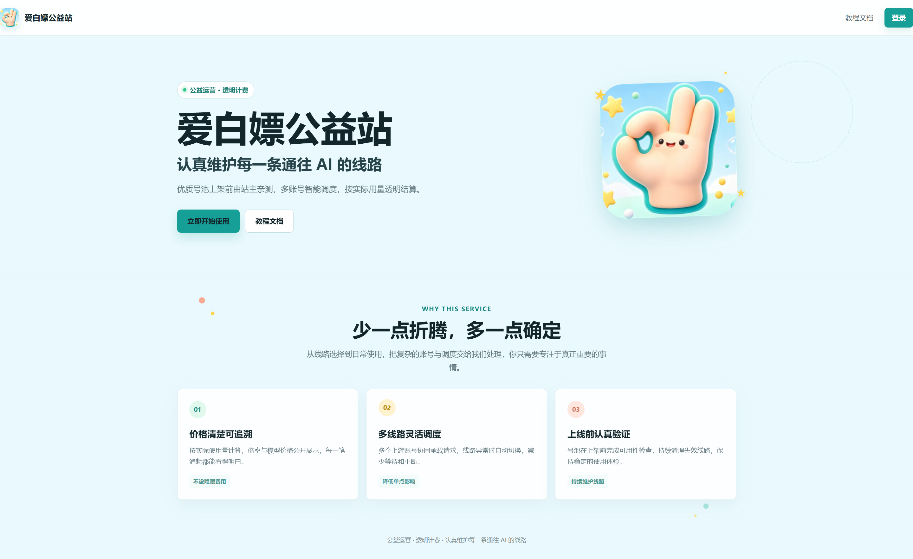
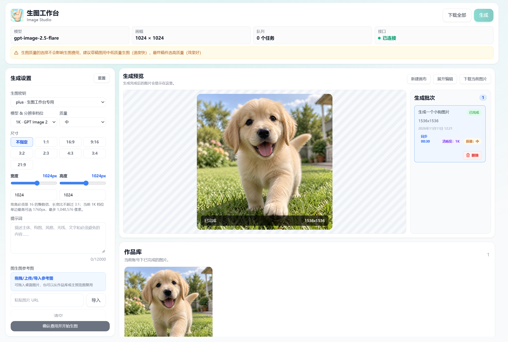
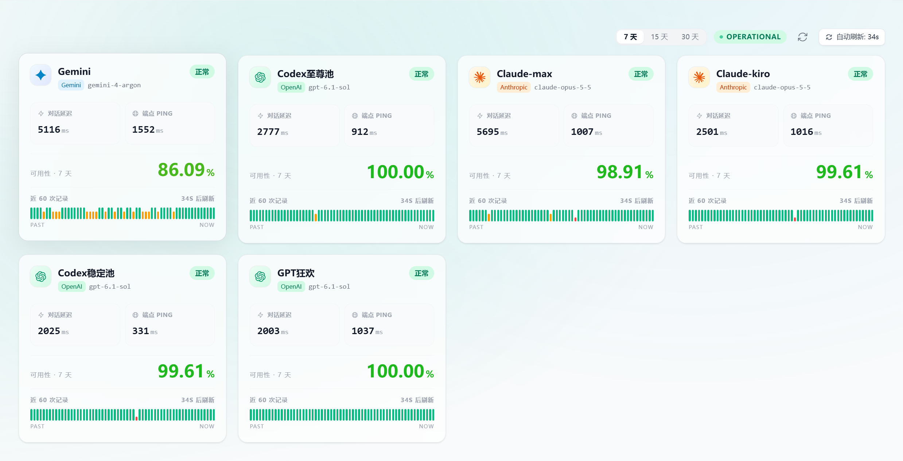
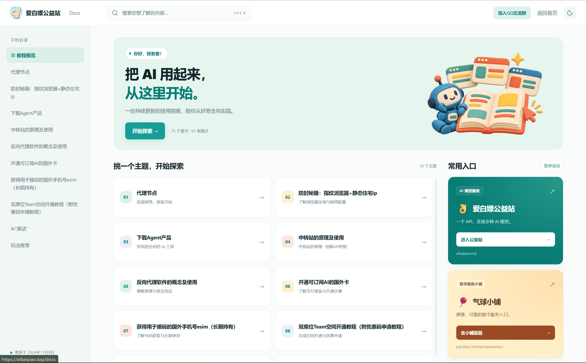
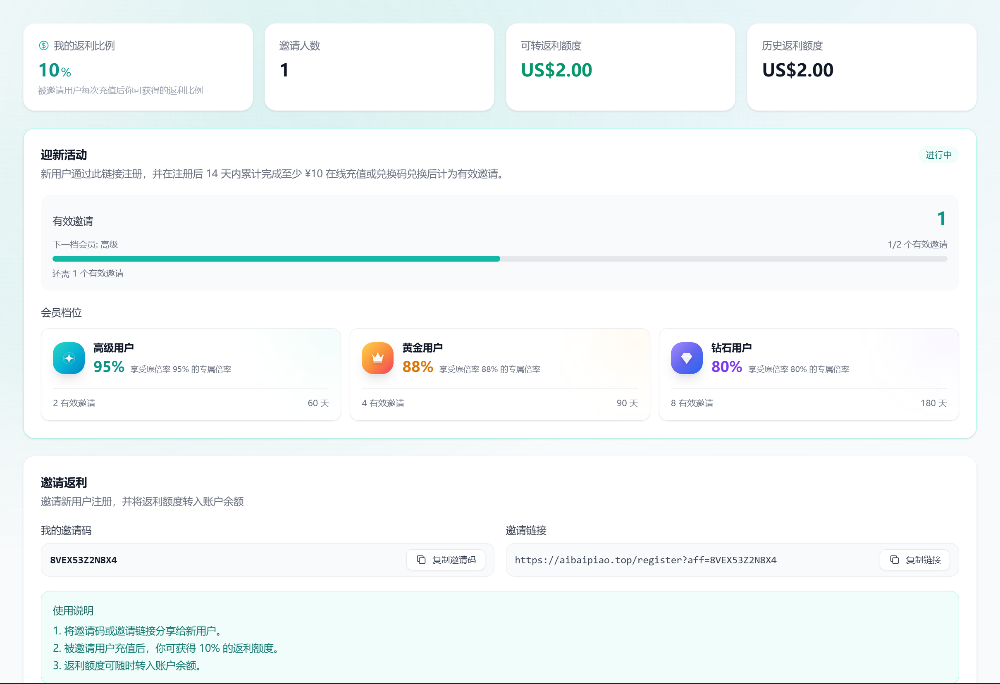

# 爱白嫖公益站

### 认真维护每一条通往 AI 的线路

多模型接入 · 在线生图 · 渠道状态可查 · 配套教程 · 邀请返利

[**进入网站**](https://aibaipiao.top) · [**开始使用**](https://aibaipiao.top/register) · [**查看模型与价格**](https://aibaipiao.top/model-plaza) · [**使用教程**](https://aibaipiao.top/docs)

---

## 主界面 · 少一点折腾，多一点确定

爱白嫖公益站提供 Claude、GPT、Gemini 等模型的统一接入入口，服务于 AI 编程、学习探索和日常创作。从线路选择到使用记录，把模型、密钥、用量和费用集中在一个控制台里。

- **价格清楚可追溯**：按实际用量计费，模型价格与倍率公开展示，每一笔消耗都能查看明细。
- **多线路灵活调度**：多个上游账号协同承载请求，线路异常时自动切换，减少等待和中断。
- **上架前认真验证**：关注号池质量与可用性，持续维护线路。

[进入网站 →](https://aibaipiao.top) · [查看模型与价格 →](https://aibaipiao.top/model-plaza)

## 生图工作台 · 把想法变成图片

直接在网页中完成图片创作：选择模型与分辨率，设置画幅和质量，输入提示词，确认费用后开始生成。也可以导入参考图，继续进行图生图创作。

- **参数自由设置**：支持常用画幅、自定义尺寸和质量选择。
- **过程集中管理**：查看生成队列、任务状态与生成批次。
- **作品随时复用**：预览图片、查看作品库，下载单张或全部图片，也可复用已有图片作为参考。

[打开生图工作台 →](https://aibaipiao.top/image-workbench)

## 渠道状态 · 线路表现，自己看得见

当前是否正常、响应需要多久、最近是否稳定，都可以在渠道状态页查看。用直观的状态卡片和历史记录，帮助你了解不同线路的实际表现。

- **当前状态**：查看渠道是否正常，以及对应的模型与平台。
- **延迟指标**：分别展示对话延迟和端点 PING。
- **历史可用性**：切换 7 天、15 天、30 天统计，结合最近的状态记录了解线路变化。

[查看渠道状态 →](https://aibaipiao.top/monitor)

## 教程文档 · 把 AI 用起来，从这里开始

从工具准备、模型接入到日常使用，配套教程帮助你一步步完成配置。按主题浏览，或直接搜索想了解的内容，需要时随时回来查阅。

- **按主题探索**：涵盖 AI 工具获取、中转站原理与使用、常见概念及玩法推荐等内容。
- **快速查找**：通过文档目录和搜索定位内容。
- **常用入口直达**：在阅读教程时，也能快速返回本站或加入交流群。

[开始阅读教程 →](https://aibaipiao.top/docs)

## 邀请返利 · 分享给朋友，也为自己积累额度

在邀请页面获取专属邀请码和邀请链接，分享给需要 AI 服务的朋友。被邀请用户完成符合规则的充值后，你可以获得返利，并将可转返利额度转入账户余额。

- **返利清楚可查**：查看自己的返利比例、邀请人数、可转额度和历史返利。
- **进度直观展示**：查看有效邀请数量，以及距离下一档会员还差多少。
- **会员专属优惠**：迎新活动提供不同会员档位及专属倍率，达成对应条件后享受相应权益。

[查看邀请与返利 →](https://aibaipiao.top/affiliate)

## 从这里开始

1. **注册并登录**：[进入爱白嫖公益站](https://aibaipiao.top/register)。
2. **选择模型**：在[模型广场](https://aibaipiao.top/model-plaza)了解可用模型和价格。
3. **按教程接入**：创建 API 密钥，参照[使用教程](https://aibaipiao.top/docs)配置工具。
4. **探索更多功能**：在线生图、查看渠道状态，或邀请朋友一起使用。

**认真维护线路，也认真对待你的每一次使用。**

[访问网站](https://aibaipiao.top) · [登录控制台](https://aibaipiao.top/login) · [使用教程](https://aibaipiao.top/docs) · [联系与交流](https://aibaipiao.top/contact)

---

可用模型、渠道状态、价格、活动及功能开放情况以站内当前展示为准。项目基于 [Sub2API](https://github.com/Wei-Shaw/sub2api) 定制，保留 [LGPL-3.0](LICENSE) 许可证与原作者版权声明。
